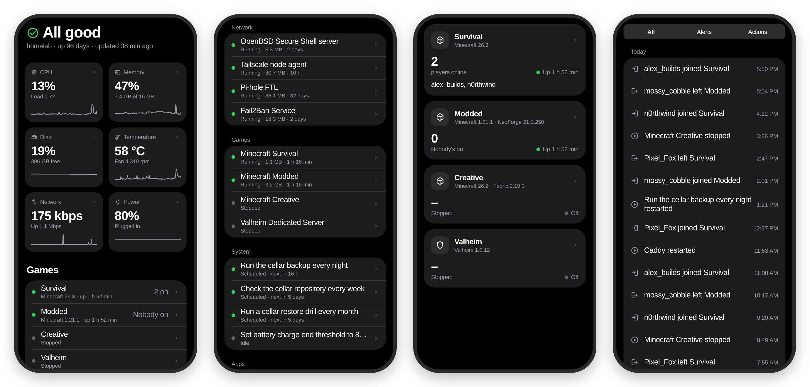
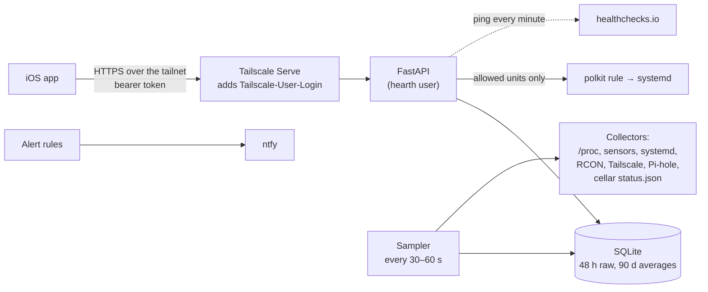

<h1 align="center">Hearth</h1>

<p align="center">Status, history, alerts and service controls for a home server, with a native iOS app.</p>

<p align="center">
  
  
  
</p>

Hearth monitors a single Linux server: an old ThinkPad that runs Minecraft (vanilla, Fabric and NeoForge) and
Valheim servers, Pi-hole and several self-hosted apps. It replaces SSHing in to run `uptime`, `sensors` and
`systemctl status` with one screen on the phone, and it pages when something needs attention.

<p align="center">
  
</p>

There are two parts:

- `server/`, a FastAPI backend that runs on the server. Every 30 to 60 seconds it samples CPU, memory, disks,
  temperatures, network, battery, a configured list of systemd units, players on the game servers, Tailscale, Pi-hole
  and the state of the nightly backups. It keeps 48 hours of raw samples and 90 days of 5-minute averages in SQLite.
- `ios/`, a native iOS app (Expo / React Native) that talks to the backend over Tailscale.

## Features

- Overview answers "is everything fine?" in one line, then shows CPU, memory, disk, temperature, network and power
  tiles with sparklines, and the state of each game server.
- Services lists every configured unit by group, with memory, uptime, restarts and recent journal lines. Units the
  config allows can be started, stopped or restarted from the phone.
- Games shows who's online on each server, sends Minecraft console commands over RCON and edits Valheim's admin,
  permitted and banned lists.
- Activity is a feed of joins, leaves, service changes, alerts and every action taken from the app.
- Every chart can be scrubbed with a finger, across ranges from 1 hour to 90 days.
- Alerts go out through [ntfy](https://ntfy.sh), with grace periods, repeats and quiet hours.

## Architecture



| Module | Role |
|---|---|
| `server/hearth/sampler.py` | Runs the collectors on a schedule and writes samples and rollups |
| `server/hearth/collectors/` | System, services, games, network and backup collectors |
| `server/hearth/rules.py`, `alerts.py` | Alert rules, grace periods, repeats, quiet hours and delivery |
| `server/hearth/actions.py`, `rcon.py` | Unit start/stop/restart, Minecraft RCON, Valheim list edits |
| `server/hearth/auth.py` | Bearer token plus the Tailscale identity check |
| `server/hearth/api.py` | The JSON API |
| `ios/src/app` | Screens, one file per route (Expo Router) |
| `ios/src/lib` | API client, formatting, status logic and actions |

## Security

The API is reachable only on the tailnet, through Tailscale Serve, and is never exposed to the internet. Every request
needs a bearer token generated at install time, and the `Tailscale-User-Login` header that Serve adds has to match the
configured owner, so a stolen token alone isn't enough.

The backend runs as a dedicated `hearth` system user rather than an interactive account. It can read the journal and
nothing in home directories except the Valheim list files. The only units it can control are the ones the config
marks, through a generated polkit rule. It isn't in the `docker` group; container CPU and memory are read from cgroups.
Every action, including refused ones, is written to an audit log.

## Alerts

Rules cover a unit that should be running and isn't, disk, memory, CPU temperature, running on battery, Tailscale key
expiry, a failed or stale backup and Pi-hole not answering. A condition has to hold for a grace period before it's
sent: 90 seconds for critical, 5 minutes for warnings, so a quick restart never pages. Each alert is sent once,
repeated every 6 hours while still critical, and followed by a "Resolved" message. During quiet hours warnings wait
until morning and are dropped if they clear first; critical alerts always go out. Message text stays vague because
anyone with the ntfy topic can read it.

A server can't report its own failure, so Hearth also pings a [healthchecks.io](https://healthchecks.io) check every
minute and healthchecks.io alerts when the pings stop.

## Install

```bash
sudo ./install.sh            # first run creates /etc/hearth/config.toml from the example and stops
sudo nano /etc/hearth/config.toml
sudo ./install.sh            # installs to /opt/hearth, starts hearth.service, runs a self-test
sudo cat /etc/hearth/token   # entered in the app once
```

Everything machine-specific (units, game servers, RCON passwords, the Pi-hole app password, thresholds) lives in
`/etc/hearth/config.toml`; `server/config.example.toml` documents each setting. `install.sh` is safe to re-run after any
change, and `sudo ./install.sh new-token` replaces the token.

## Development

```bash
cd server
uv sync
uv run pytest -q
HEARTH_CONFIG=/path/to/dev-config.toml uv run uvicorn --factory hearth.main:app --port 8010
```

The app, from `ios/`:

```bash
npm install
echo 'EXPO_PUBLIC_HEARTH_URL=https://<server>.<tailnet>.ts.net:8446' > .env.local   # not committed
npx expo start --port 8083
```

With Expo Go and Tailscale on the phone, open `exp://<server's Tailscale IP>:8083`. For a standalone build with a free
Apple ID, run `npx expo run:ios --device --configuration Release` on a Mac with the phone connected, after picking a
Personal Team under Signing & Capabilities in `ios/ios/Hearth.xcworkspace`. Re-running the same command reinstalls
over the old copy and keeps the token and cached data.

For layout work without a phone, `npx expo start --web --port 8083` plus
`HEARTH_TOKEN=... HEARTH_LOGIN=<owner> node scripts/preview.mjs` serves the web build and the API from one origin on
`http://127.0.0.1:8091`, adding the credentials the phone would send. It only listens on localhost.
`ios/DESIGN.md` covers the design decisions.

## API

JSON under `/api`. `/api/ping` is the only route that doesn't need auth.

- Reading: `overview`, `system`, `issues`, `services`, `services/{unit}` (with recent journal lines), `games`,
  `games/{id}`, `network`, `backups`, `history?key=cpu&range=24h` (1h, 6h, 24h, 7d, 30d, 90d), `events`, `alerts`,
  `audit`.
- Changing things: `POST services/{unit}/{start|stop|restart}` (only what the config allows for that unit),
  `POST games/{id}/rcon`, `GET/POST/DELETE games/{id}/lists/...` for Valheim's lists, and `POST alerts/test`.

## Known limitations

- One server and one owner. There's no multi-host view or multi-user access.
- Linux with systemd only; collectors read `/proc`, `/sys`, `lm-sensors` and the journal directly.
- Game support is Minecraft (via RCON) and Valheim (via its list files and logs).
- Apps signed with a free Apple ID expire after 7 days and have to be reinstalled from Xcode, and push notifications
  aren't available, which is why alerts go through ntfy.

## License

MIT. See [LICENSE](LICENSE).
